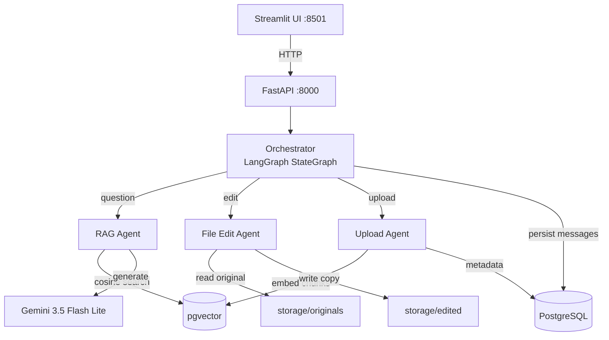

# Multi-Agent PDF Assistant

A production-quality agentic system where users upload PDF documents and interact with them through chat. Multiple specialized agents handle different parts of the workflow, orchestrated by a LangGraph StateGraph.

---

## Architecture



## Agent Responsibilities

| Agent | Responsibility |
|---|---|
| **Orchestrator** | Classifies user intent (question / edit / upload) via Gemini and routes to the correct agent using a LangGraph StateGraph |
| **Upload Agent** | Validates PDF, extracts text page-by-page (PyMuPDF), chunks with LangChain splitter, embeds with Gemini, stores in pgvector |
| **RAG Agent** | Embeds question, retrieves top-5 chunks via cosine similarity, builds cited prompt, calls Gemini, returns answer with `[p.N]` citations |
| **File Edit Agent** | Parses natural-language instruction via Gemini function-calling, applies replace/redact/remove-pages to a copy of the original PDF |

---

## Quickstart with Docker

**1. Clone and configure**
```bash
git clone https://github.com/Diwash17/Multi-Agent-PDF-Assistant.git
cd Multi-Agent-PDF-Assistant
cp .env.example .env
# Edit .env and set your GEMINI_API_KEY
```

**2. Start all services**
```bash
docker compose up --build
```

**3. Run database migrations**
```bash
docker compose exec backend alembic upgrade head
```

**4. Open the app**
- Streamlit UI: http://localhost:8501
- FastAPI docs: http://localhost:8000/docs

---

## Local Development (without Docker)

**Prerequisites:** Python 3.11, `uv`, PostgreSQL with pgvector on port 5433

**Setup**
```bash
uv venv
uv sync
cp .env.example .env
# Edit .env — set GEMINI_API_KEY and DATABASE_URL
```

**Start the database (Docker)**
```bash
docker compose up db -d
uv run alembic upgrade head
```

**Run backend**
```bash
uv run uvicorn backend.api.main:app --host 0.0.0.0 --port 8000 --reload
```

**Run frontend**
```bash
uv run streamlit run frontend/app.py --server.port 8501
```

---

## Environment Variables

| Variable | Description | Default |
|---|---|---|
| `DATABASE_URL` | PostgreSQL connection string (use `postgresql+psycopg2://`) | `postgresql+psycopg2://postgres:postgres@db:5432/pdf_assistant` |
| `GEMINI_API_KEY` | Google Gemini API key — get one at [aistudio.google.com](https://aistudio.google.com/app/apikey) | — |
| `BACKEND_URL` | URL the Streamlit frontend uses to reach the FastAPI backend | `http://backend:8000` |
| `MAX_UPLOAD_SIZE_MB` | Maximum PDF upload size in megabytes | `20` |

---

## API Reference

| Method | Path | Description |
|---|---|---|
| `GET` | `/health` | Liveness probe |
| `POST` | `/conversations` | Create a new conversation |
| `GET` | `/conversations` | List all conversations |
| `GET` | `/conversations/{id}` | Get a single conversation |
| `POST` | `/conversations/{id}/documents` | Upload and index a PDF |
| `GET` | `/conversations/{id}/documents` | List documents in a conversation |
| `GET` | `/conversations/{id}/documents/{doc_id}/download-edited` | Download edited PDF |
| `POST` | `/conversations/{id}/documents/{doc_id}/edit` | Apply a direct edit instruction |
| `POST` | `/conversations/{id}/messages` | Send a message (routed via orchestrator) |
| `GET` | `/conversations/{id}/messages` | Get full message history |

---

## Tech Stack

| Component | Technology |
|---|---|
| Backend | FastAPI + Uvicorn |
| Orchestration | LangGraph + LangChain |
| LLM | Google Gemini 3.5 Flash Lite |
| Embeddings | Google Gemini Embedding 001 (3072-dim) |
| Database | PostgreSQL 16 + pgvector |
| PDF processing | PyMuPDF |
| Frontend | Streamlit |
| Package manager | uv (Python 3.11) |
| Containers | Docker Compose |

---

## Project Structure

```
Multi-Agent-PDF-Assistant/
├── backend/
│   ├── agents/
│   │   ├── orchestrator.py     # LangGraph StateGraph — intent classification + routing
│   │   ├── upload_agent.py     # PDF ingestion pipeline
│   │   ├── rag_agent.py        # Retrieval + Gemini answer generation
│   │   └── file_edit_agent.py  # Natural-language PDF editing
│   ├── api/
│   │   ├── main.py             # FastAPI app + global exception handlers
│   │   └── routes/
│   │       ├── conversations.py
│   │       ├── documents.py
│   │       └── messages.py
│   ├── db/
│   │   ├── models.py           # SQLAlchemy ORM models
│   │   └── session.py          # Engine + get_db() dependency
│   ├── core/
│   │   ├── config.py           # Pydantic BaseSettings + extract_llm_text helper
│   │   ├── state.py            # LangGraph GraphState TypedDict
│   │   └── exceptions.py       # Typed exception hierarchy
│   └── storage/
│       ├── originals/          # Uploaded PDFs (never modified)
│       └── edited/             # Edited PDF copies
├── frontend/
│   └── app.py                  # Streamlit UI
├── alembic/                    # Database migrations
├── docker-compose.yml
├── Dockerfile.backend
├── Dockerfile.frontend
├── pyproject.toml
└── .env.example
```
